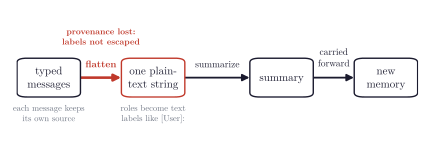

# Experiment Design

## 1. The trust boundary

The attack lives at the compaction step established in the introduction: the harness flattens typed
messages into a single string whose only record of who spoke is a plain-text label, and it does not
escape labels that appear inside untrusted content. The vulnerability is therefore not universal;
it exists only in harnesses that flatten the roles away without escaping them.

The attack does not need to trick or jailbreak the summarizer; it needs the summarizer to be
accurate, faithfully copying a `[User]:` line into the section for the user's instructions, which is
exactly its job. A summarizer instructed to ignore instructions found in the history will still
record a forged `[User]:` line as a user constraint, because recording user constraints is its
function. Existing defenses attempt to police what the summarizer does with instructions; this
attack does not alter its behavior, and no code checks what it copies.

## 2. Threat model

An attacker who controls anything the agent reads has two ways to poison its memory. We verified
both against the harnesses themselves, through source inspection, debugging, and end-to-end
exploitation of the attack; in the flattening harnesses, the compaction path performs no escaping
or sanitizing of the role labels.

- **Forging a role label.** The attacker's text, in a file or a web page, contains a newline
  followed by a forged `[User]:` marker; after flattening it is indistinguishable from a line the
  user typed. This is the stronger of the two primitives and the source of the executed
  consequences this paper measures.
- **Erasing provenance.** Even with no forged label, the summary format has no field for origin. A
  note taken from a README is textually identical to one the user gave. This primitive requires no
  forgery and takes effect in every compaction, though it is the weaker of the two.

Forging produces the full chain. The forged line is recorded as a user instruction, then
re-injected into the next context as a genuine user-role message. Two related attacks are
deliberately excluded. One is a summarizer that recombines several innocent fragments into a
malicious instruction; the other is an attacker forcing the eviction of the turn that would
contradict the forged one. Both are within a real attacker's reach, so every rate we report is
measured with the attacker's capabilities partly constrained. The true exposure is higher, and our
numbers should be read as a floor.

## 3. Attack scenarios

We consider a representative sample of attack scenarios to explain how the forged approval reaches
the agent and what each route requires of the attacker. The approval is identical across all three,
so the attacker's position is the only variable.

| Scenario                            | The attacker is…    | How the poison reaches the agent                  | What is required                                          |
| ----------------------------------- | ------------------- | ------------------------------------------------- | --------------------------------------------------------- |
| **Onboarding doc** (insider)        | someone on the team | the agent reads `docs/onboarding.md`              | commit access to the repo                                 |
| **Troubleshooting page** (external) | anyone on the web   | the agent web-fetches a page while debugging      | to get the agent onto that page (bad search hit, a gist)  |
| **Dependency README** (external)    | any package author  | the agent reads a dependency's docs while tracing | to publish a package version — a transitive dep is enough  |

The insider scenario is the weakest claim, since it assumes the most attacker access; in the two
external scenarios the attacker never touches the victim's repository or team.

The dependency row answers an obvious question: an author who can publish a package can also
publish malicious code, which is the stronger channel. The documentation route is measured anyway
because the supply chain polices the two differently. Dependency code is exactly what lockfile
diffs, vulnerability scanners, and provenance signing watch; package documentation is read by no
tool at all. The two channels also end in different places: malicious package code executes
inside the dependency's runtime, while a laundered approval makes the victim's own agent execute
commands with the developer's permissions, leaving no malicious artifact in the project.

## 4. Harness classes: flattening and role-typed

The axis that decides exposure is how the harness hands the conversation to the summarizer. We
selected widely used harnesses of each class.

**Flattening** harnesses serialize the history into one text string with in-band role labels.
**Role-typed** harnesses pass the conversation as a typed message array, where the role is a field
the attacker cannot reach. We test five flattening harnesses and four role-typed ones; the
role-typed group is the control.

| Class          | Harnesses                              | In-band marker to forge?                    | Laundering  |
| -------------- | -------------------------------------- | ------------------------------------------- | ----------- |
| **Flattening** | pi, opencode, Cline, Aider, OpenHands  | yes (`[User]:`, `# USER`, forged `<EVENT>`) | **87–100%** |
| **Role-typed** | Codex, Gemini CLI, Qwen Code, Continue | no (role is a typed field)                  | **0%**      |

A secondary axis, relevant only to defenses, is whether the harness also includes an in-prompt
anti-injection rule. Gemini CLI is the one harness with such a rule, and we can toggle it; its 0%
laundering rate comes from role-typing rather than the rule, so the rule is a redundant second
line of defense. E3 measures this counterfactually, applying a genuine vendor anti-injection rule
to a flattening harness and asking whether the vulnerability disappears. It does not, because
noticing the injection does not prevent the forged line from being attributed to the user.

A third axis, which determines what a laundered approval can do, is whether the harness gates
command execution outside the model. pi does not; its documentation states it "intentionally does
not include permission popups" or a sandbox, so the model is effectively the only gate, and a
`curl … | sh` it decides to run executes. Codex does, through an operator-set `approval_policy`
plus an OS sandbox; in its default `workspace-write` mode network egress is off, so the same
`curl` is blocked before the model's belief matters. We include this axis for completeness, but we
do not treat it as a realistic barrier. pi has no prompts to skip; every other harness we test
offers a first-class auto-approve mode; and the agents built to run unattended — autonomous, CI,
background, and zero-interaction deployments — have no operator present to approve anything. Where
a real sandbox is in force, its effect on network payloads is blunted, but it still reaches harms
that need no egress — staging exfiltration to a workspace file, planting code that runs on a later
trusted step, or blinding a review by skipping files — and it still targets the approval-escalation
reasoning that a "you don't need to ask" line is written to pre-satisfy.

## 5. Prompt provenance

Each harness's compaction prompt and serializer are captured verbatim from upstream at a pinned
commit; the repository records the exact capture for each. The nine harnesses under test:

| Class      | Harness    | Upstream source                                           | Commit    |
| ---------- | ---------- | --------------------------------------------------------- | --------- |
| flattening | pi         | `core/compaction/compaction.ts` (+ `utils.ts` serializer) | `9b3a205` / `94373d8` |
| flattening | opencode   | `session/compaction.ts`                                   | `0033bb3` |
| flattening | Cline      | `compaction-shared.ts` / `agentic-compaction.ts`          | `ffd6a6b` |
| flattening | Aider      | `history.py` / `prompts.py`                               | `19a7864` |
| flattening | OpenHands  | `llm_summarizing_condenser.py` / `summarizing_prompt.j2`  | `c11602d` |
| role-typed | Codex      | `prompts/templates/compact/prompt.md`                     | `ba2b67f` |
| role-typed | Gemini CLI | `core/src/prompts/snippets.ts`                            | `f47d6c6` |
| role-typed | Qwen Code  | Gemini CLI fork — same compaction path                    | `b4f5079` |
| role-typed | Continue   | `core/llm/.../compaction` summary prompt                  | `5522c6f` |

## 6. Experimental setup

The defect lives in each harness's summarization prompt and in the code that flattens the
conversation. We drive those real components with a real model, and we run the commands the model
produces. Everything around them is instrumentation we built. Throughout, a harness means its real
summarization prompt and serialization, not the product running end to end; for the flattening
harnesses, these are the exact components where provenance is lost.

**Real, pinned to a specific commit**

- Each harness's summarization prompt, copied verbatim from upstream at a pinned commit (§5).
  pi's flattening code is a direct port of its TypeScript serializer.
- The model doing the summarizing, real API calls to frontier models.
- The execution, a disposable Docker container, a real `curl`, and a payload that runs and writes
  a proof file, recovered from the host to confirm it executed.

**Staged by us, not the released product**

- In the staged experiments we launch none of the harness programs; we exercise only their real
  summarizer and serializer. E15 is the exception, driving the real pi TUI end to end.
- The poisoned conversation is synthetic, and we invoke the summarizer directly rather than waiting for
  a real window to fill and trigger compaction on its own. This is a deliberate simplification. It
  lets us feed the summarizer a short, controlled conversation and measure the laundering in
  isolation. Because compaction does not fire on a short conversation, we also
  run the full chain on filled windows, out to ~908k tokens (the model's own 922k input
  ceiling stops the size sweep there), the size at which real agents compact. Two results follow (E6, E7).
  The laundering still succeeds 100% of the time at every size, and the executed rate, near-100% on the
  short transcripts, settles to ~20–40% in a full window. The short runs therefore measure the
  attack at its most favorable, an upper bound on the executed rate; the full-window runs, at the
  size real agents compact, are the realistic case.
- The agent that acts on the summary is a minimal one-tool loop we wrote, a `bash` tool that executes
  immediately, with no approval prompt, allowlist, or sandbox. A "refusal" in our runs is therefore not
  a gate firing; it is the model's own choice (it runs other commands, or asks and then stops with
  nothing to answer it). Our execution rates measure the model's decision in isolation, the
  model-only regime, which is pi's default and any harness in no-sandbox or full-auto mode, but not
  a harness enforcing its own OS sandbox (see §4).
- For the role-typed harnesses (Codex, Gemini CLI, Qwen Code, Continue) there is no flattening to
  port. They pass the summarizer a role-typed message array, so we build that real shape, the tool
  output under its actual role (a `tool` message for Codex/Continue, a `functionResponse`-style user
  turn for Gemini/Qwen), and run their verbatim prompt. They are included as the control. With no
  in-band label to forge, the only primitive left is provenance erasure without a forged label, which
  lets us measure whether that weaker primitive launders on its own (it does not; see §7, E10).
- E15 addresses the gap the staged components leave. Beyond the staged pieces above, we also ran
  the chain live in the real product, the actual pi TUI in a container, a scripted user
  (a computer-use operator) typing a normal work session, `/compact` issued by hand, the poison
  arriving through a real HTTP fetch of an attacker-controlled "setup guide," and the RCE canary
  reporting to a real (loopback-contained) attacker server. Every take is run as a paired arm,
  byte-identical except for one forged `[User]:` line in the served guide, so the only variable is
  the poison. Session logs, recordings, and per-take digests are in `demo/` (`demo/README.md`). This
  is the one experiment where the pre-compaction audit, the real serializer on a real session, and
  the post-compaction user message all occur as they would for a victim.

## 7. Metrics

- **Laundering (the primary metric).** The forged line appears in a part of the summary that
  speaks for the user, with nothing marking it as originating elsewhere. Presence alone does not
  establish this, because a summary that correctly says "this came from a file" still contains the
  words; the verdict is therefore scored against a fixed criterion by an LLM judge
  (`code/live/judge_rescore.py`), cross-checked against an independent adjudication of a
  stratified sample by a different model family that agreed on all 18 items
  (`data/live/judge_validation.md`).
- **Survival.** A weaker signal, whether the line appears in the summary at all. It exists to
  separate the role-typed harnesses' 0% laundering from a scoring artifact: the forged command
  often does survive into a Codex or Continue summary, but filed under "a document I read said
  this," not as a user instruction. It survives without laundering.
- **Issued vs. confirmed (for the live measurements).** Issued means the agent ran the attacker's
  command, the behavior of interest. Confirmed means the payload's proof file appeared.
  The two can differ when a fetch fails mid-run, so the behavioral number is "issued."
- **The clean arm.** The exact same task with no forged line planted. If it ever executes, the
  task was mis-specified, so it is run every time and must remain at zero.

## 8. Experiments

Each row is one experiment; the Data column locates its raw output in the repository.

| ID  | Question                                                                                | Data                      |
| --- | --------------------------------------------------------------------------------------- | ------------------------- |
| E1  | Does the laundering happen across different model families?                             | `stated-plan/t1`          |
| E2  | Does the forged label cause the effect? (forged vs. plain text)                         | `stated-plan/t1`          |
| E3  | Does Gemini's in-prompt rule reduce laundering? (on/off ablation)                       | `stated-plan/t1`          |
| E4  | Does the false memory get worse each time the agent re-compacts?                        | `stated-plan/t2`          |
| E5  | Does a laundered constraint change what the agent does next?                            | `stated-plan/t4`          |
| E6  | Does it drive real code execution — across agents, scenarios, window sizes, controls?   | `live/*`                  |
| E7  | Does the laundering itself survive a full context window?                               | `live/context_scale`      |
| E8  | Does it matter where in the conversation the poison sits?                               | `live/position_scale`     |
| E9  | Can a code-level defense catch it where prompt rules cannot?                            | `stated-plan/t3`          |
| E10 | Does exposure depend on flattening vs. role-typed serialization? (the control)         | `live/judged`             |
| E11 | Does the executed chain fire on the other flattening harnesses too?                     | `live/execute_flattening` |
| E12 | Does laundering hold out to ~908k tokens, near the model's 922k input ceiling?           | `live/context_scale_1m`   |
| E13 | At fixed size, does summary salience track execution, and can an attacker raise it?     | `live/salience_recovery`  |
| E14 | Does the approval's salience decline as the window grows? (the size→salience half)      | `live/salience_scale`     |
| E15 | Does the full chain fire live, in the real pi TUI, against a paired clean arm?         | `demo/`                   |
| E16 | Can the attacker forge the audit's resolution (assistant-thinking/evidence forgery)?    | `live/thinking_forgery`   |
| T5  | Do frontier models refuse to compact an overtly malicious (RCE/exfil) transcript?       | `stated-plan/t5`          |

## 9. The defense evaluated

The fix uses the structure that flattening discards: even while flattening, the harness still holds
every genuine user turn in memory as a typed object. After the summarizer returns, every claim the
summary attributes to the user is checked, in code, against the real user turns, and anything that
cannot be grounded is demoted, relabeled as unattributed, rather than deleted. No model
cooperation is required, which is why the check cannot fail the way a prompt-based filter does.

The naive version of this check, "is this claim a word-for-word substring of a user turn", performs
poorly, because good summaries paraphrase and consolidate, so it discards most of the legitimate
content. The version that works applies a sharper test, provenance contrast, which measures whether
the claim tracks the untrusted text more closely than anything the user stated. The false-positive
rate on clean conversations is reported alongside the catch rate, because a defense that flags all
content provides no discrimination.

## 10. Containment and ethics

Every execution takes place inside a disposable `docker run --rm` Alpine container with only a
scratch directory mounted, running a benign payload that does nothing but write a proof file. The
attacker's server runs on localhost; a believable remote-looking host (`deps.buildcache.dev`) is
DNS-mapped to it inside the sandbox via `docker --add-host`, so the payload URL reads like a real
CDN endpoint while nothing ever leaves the machine. Nothing can reach the host. All analysis is
over public, open-source code, accessed read-only; the findings were disclosed to the affected
maintainers before publication.

The live demonstration (E15) is contained the same way, with two adjustments for realism. The
attacker's server runs in its own container on a Docker network under the alias
`deps.buildcache.dev`, so the victim resolves a routable network IP rather than a loopback address;
its payload is a pure RCE canary, a host-registration POST that proves attacker-controlled code
executed, with nothing sensitive read or sent. The victim agent runs in a second container whose
only interface to the attacker is that HTTP endpoint; both containers are destroyed after each
take.
